<p align="center">
  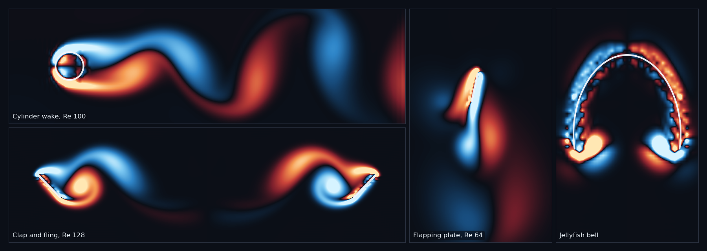
</p>

<h1 align="center">pyIBM</h1>

<p align="center">
  A two-dimensional immersed boundary method in Python.<br>
  <a href="docs/user-guide.md">User guide</a> &middot;
  <a href="docs/numerics.md">Numerics</a> &middot;
  <a href="docs/examples.md">Examples</a> &middot;
  <a href="tutorials/README.md">Tutorials</a>
</p>

<p align="center">
  
  
  
</p>

pyIBM simulates elastic structures immersed in a viscous incompressible fluid with Peskin's
immersed boundary method. The structure is a set of Lagrangian points joined by springs,
beams, tethers and masses; the fluid lives on a fixed Cartesian grid; and a discrete delta
function or the blob projection of Cortez & Minion carries forces to the fluid and
velocities back. It is written from the equations of Peskin & McQueen (1996), Peskin (2002),
Cortez & Minion (2000) and Seibold (2008), and it grew out of Laura Miller's 2008 MATLAB
code, which it still reproduces to round-off. The input and structure files follow the
layout of IB2d, so IB2d users will find their way around. The code is plain NumPy and SciPy.
Most examples are checked against an exact solution, a published computation or the 2008
code; the others say plainly that they are demonstrations.

## Features

- **Two fluid solvers.** A doubly periodic FFT solver, with the first-order scheme of Peskin
  & McQueen (1996) and the second-order midpoint scheme of Peskin (2002); and a MAC-grid
  projection solver after Seibold (2008) with no-slip, moving, inflow, outflow and periodic
  sides whose data vary in space and time, implicit or explicit viscosity, and a
  non-incremental or incremental pressure projection.
- **Two couplings.** Discrete delta functions (Peskin's 4-point kernel, the 1977 cosine
  kernel, the 3-point kernel of Roma, Peskin & Berger) and the blob projection method of
  Cortez & Minion (2000), with a divergence-free marker velocity that keeps the area of a
  closed membrane.
- **Structures.** Springs (Hookean or power-law), damped springs, torsional beams,
  non-invariant beams, target points with optional damping, and mass points that feel
  gravity. All forces are derivatives of an energy per unit length.
- **IB2d-style files.** An `input2d` parameter file and `.vertex`, `.spring`, `.d_spring`,
  `.beam`, `.nonInv_beam`, `.target`, `.mass` structure files. Indices are 0-based, as in
  the Python version of IB2d; subtract 1 from files of the MATLAB version. The first line of
  a structure file must be its row count, and without an explicit `ds` every point gets the
  median nearest-neighbour spacing ([`docs/user-guide.md`](docs/user-guide.md), structure
  files).
- **Hooks in plain Python** for prescribed motion, changing rest lengths and curvatures,
  boundary data, body forces, an initial velocity and your own diagnostics.
- **Output** as a CSV history of forces and diagnostics, legacy VTK files for ParaView or
  VisIt, and PNG snapshots of the vorticity.
- **Sixteen worked examples** and three tutorial notebooks, each with tests.

## Install

pyIBM needs Python 3.11 or newer and depends only on `numpy`, `scipy` and `matplotlib`.

From the root of a clone of this repository:

```
pip install -e .
```

Optional extras: `pip install -e ".[test]"` adds `pytest` for the test suite, and
`pip install -e ".[notebooks]"` adds Jupyter for the tutorials.

## Quick start

Run the rubber band, an ellipse of springs that relaxes to a circle, with both couplings (a
few seconds each), and compare the area it encloses:

```
python -m pyibm run examples/rubberband
python -m pyibm run examples/rubberband --input input2d_blob
python examples/rubberband/analyze.py
```

The run prints one line per output step and writes `history.csv`, VTK files and
`area.csv` to `examples/rubberband/viz/`. From Python:

```python
import pyibm

result = pyibm.run("examples/rubberband", quiet=True)
print(result.history.t[-1], result.structure.X.shape, result.wall_time)
```

A case is a folder with an input file, the structure files and an optional `hooks.py`.
[`docs/user-guide.md`](docs/user-guide.md) describes every key of the input file, the
structure files, the hooks and the output.

## Examples

Each folder has a README with the physics, the parameters, how to run it, and the numbers to
expect next to the reference. Some examples reproduce their reference closely, some only in
part, and a few are demonstrations; [`docs/examples.md`](docs/examples.md) has the summary
table: what each example shows, the reference, how well it agrees and how long it takes.

<table>
  <tr>
    <td align="center" width="25%"><a href="examples/heaving_plate_2008">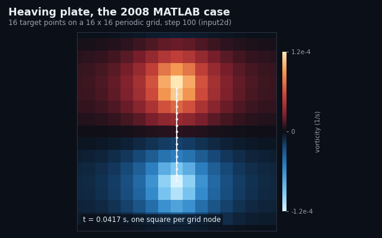<br><b>heaving_plate_2008</b></a><br>the 2008 MATLAB case, to round-off</td>
    <td align="center" width="25%"><a href="examples/taylor_green">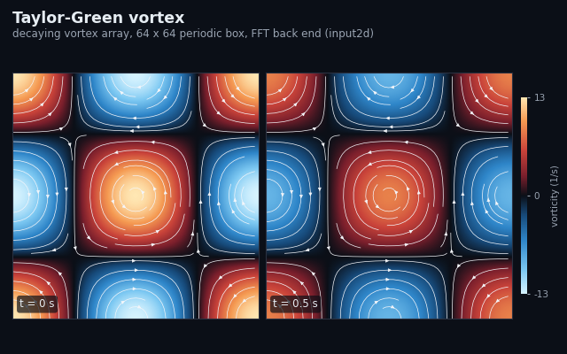<br><b>taylor_green</b></a><br>exact decay, orders of accuracy</td>
    <td align="center" width="25%"><a href="examples/lid_driven_cavity">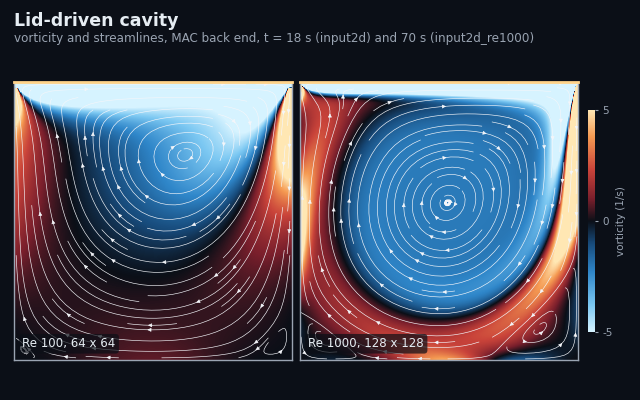<br><b>lid_driven_cavity</b></a><br>Ghia et al. 1982, Re 100-1000</td>
    <td align="center" width="25%"><a href="examples/stokes_second_problem">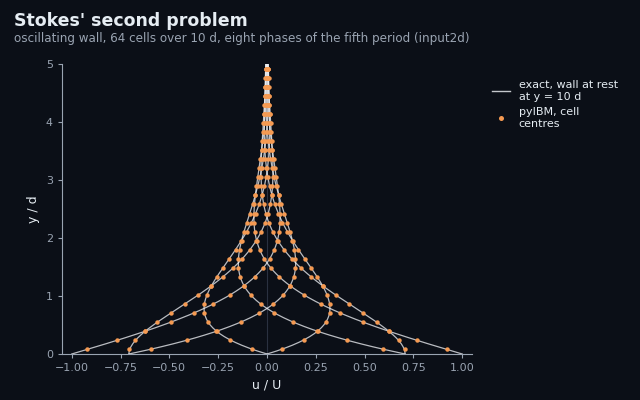<br><b>stokes_second_problem</b></a><br>oscillating wall, exact solution</td>
  </tr>
  <tr>
    <td align="center"><a href="examples/womersley_channel">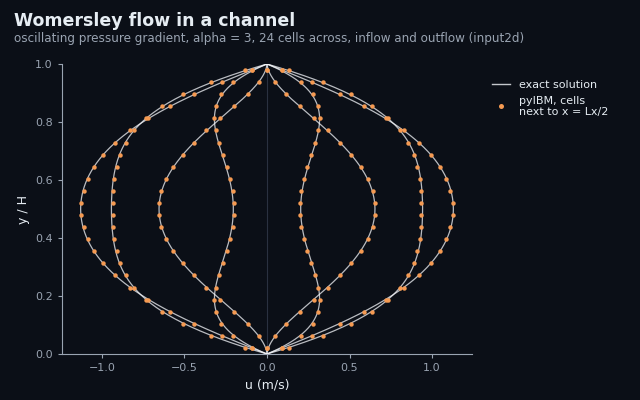<br><b>womersley_channel</b></a><br>pulsatile channel flow</td>
    <td align="center"><a href="examples/cylinder_wake">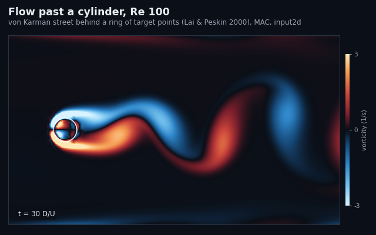<br><b>cylinder_wake</b></a><br>vortex street, Lai &amp; Peskin 2000</td>
    <td align="center"><a href="examples/flapping_filament">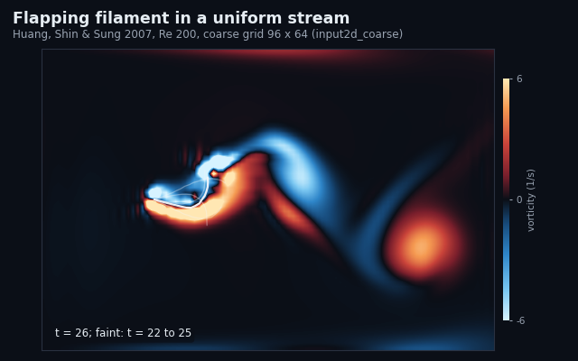<br><b>flapping_filament</b></a><br>a flag in a stream, Huang et al. 2007</td>
    <td align="center"><a href="examples/flapping_plate_re64">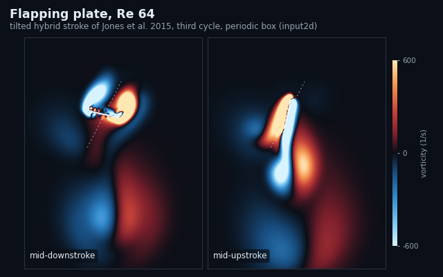<br><b>flapping_plate_re64</b></a><br>hovering plate, Jones et al. 2015</td>
  </tr>
  <tr>
    <td align="center"><a href="examples/clap_and_fling">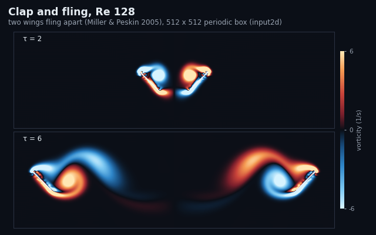<br><b>clap_and_fling</b></a><br>two-winged fling, Miller &amp; Peskin 2005</td>
    <td align="center"><a href="examples/jellyfish_bell">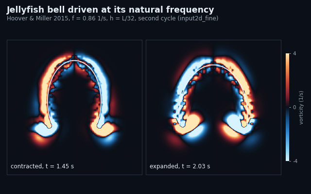<br><b>jellyfish_bell</b></a><br>a driven bell, Hoover &amp; Miller 2015</td>
    <td align="center"><a href="examples/heart_tube">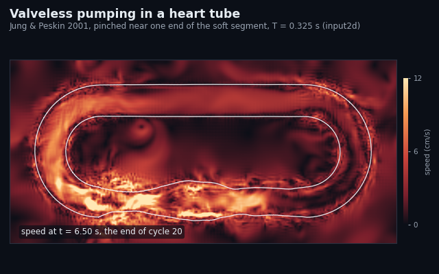<br><b>heart_tube</b></a><br>valveless pumping, Jung &amp; Peskin 2001</td>
    <td align="center"><a href="examples/swimmer">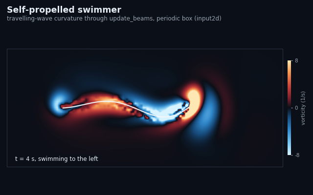<br><b>swimmer</b></a><br>a self-propelled filament</td>
  </tr>
  <tr>
    <td align="center"><a href="examples/sedimenting_ring">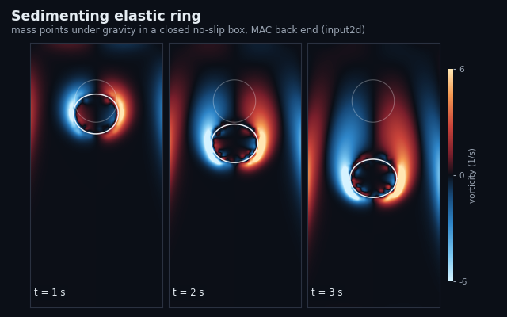<br><b>sedimenting_ring</b></a><br>a heavy ring falling in a box</td>
    <td align="center"><a href="examples/rubberband">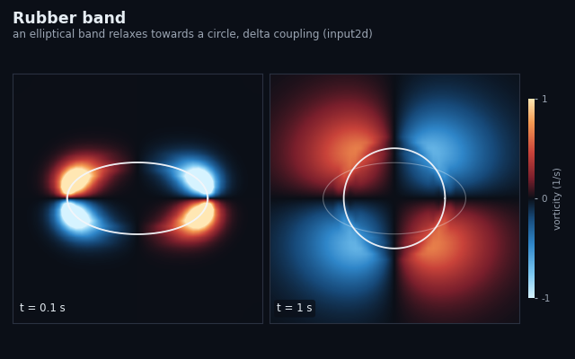<br><b>rubberband</b></a><br>an ellipse relaxing to a circle</td>
    <td align="center"><a href="examples/blob_ellipse">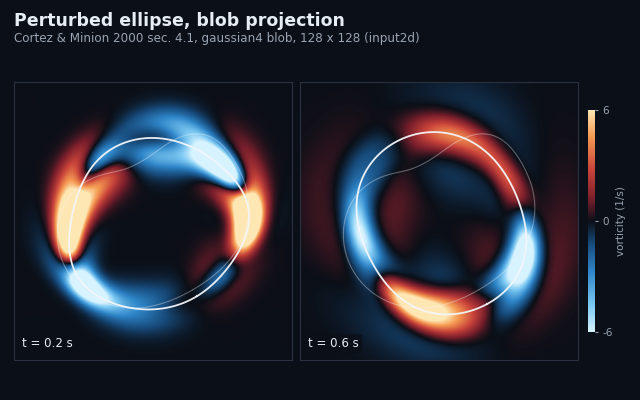<br><b>blob_ellipse</b></a><br>area conservation, Cortez &amp; Minion 2000</td>
    <td align="center"><a href="examples/forced_circle">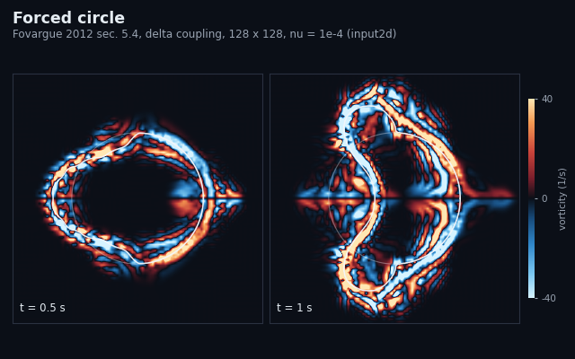<br><b>forced_circle</b></a><br>error against the time step, Fovargue 2012</td>
  </tr>
</table>

## Tutorials

Three notebooks in [`tutorials/`](tutorials/README.md) take the equations of a source paper
in order and run each piece with pyIBM:

- [](https://colab.research.google.com/github/fairyflies9/pyIBM/blob/main/tutorials/01_peskin_mcqueen_1996_immersed_boundary.ipynb) `01_peskin_mcqueen_1996_immersed_boundary.ipynb`: the periodic immersed boundary method of
  Peskin & McQueen (1996) and the midpoint scheme of Peskin (2002), ending with the 2008
  heaving plate reproduced against the MATLAB data.
- [](https://colab.research.google.com/github/fairyflies9/pyIBM/blob/main/tutorials/02_projection_method_mac_dirichlet.ipynb) `02_projection_method_mac_dirichlet.ipynb`: the MAC projection method after Seibold
  (2008), with walls, inflow and outflow that vary in time, and an immersed boundary in a
  channel.
- [](https://colab.research.google.com/github/fairyflies9/pyIBM/blob/main/tutorials/03_blob_projection_method.ipynb) `03_blob_projection_method.ipynb`: the blob projection method of Cortez & Minion (2000)
  and how it compares with delta-function spreading.

## Documentation

- [`docs/user-guide.md`](docs/user-guide.md): installing, running a case, the input file,
  the structure files, the hooks, the output.
- [`docs/numerics.md`](docs/numerics.md): the grids, kernels, couplings, time schemes and
  fluid solvers, the conventions, and the known limitations.
- [`docs/examples.md`](docs/examples.md): every example with its reference and how well it
  agrees.

## Tests

```
python -m pytest -q             # the default suite
python -m pytest -q -m slow     # the long comparisons with published and analytic results
```

## How to cite

If you use pyIBM in published work, please cite the repository and the papers whose methods
you used:

- C. S. Peskin and D. M. McQueen (1996). Fluid dynamics of the heart and its valves. In H. G.
  Othmer, F. R. Adler, M. A. Lewis and J. C. Dallon (eds.), *Case Studies in Mathematical
  Modeling: Ecology, Physiology, and Cell Biology*, chapter 14, pp. 313-342. Prentice Hall.
- C. S. Peskin (2002). The immersed boundary method. *Acta Numerica* 11, 479-517.
- R. Cortez and M. Minion (2000). The blob projection method for immersed boundary problems.
  *Journal of Computational Physics* 161, 428-453.
- B. Seibold (2008). A compact and fast Matlab code solving the incompressible Navier-Stokes
  equations on rectangular domains. Course notes for MIT 18.086.
- The input and structure file formats follow IB2d: N. A. Battista, W. C. Strickland and
  L. A. Miller (2017), IB2d: a Python and MATLAB implementation of the immersed boundary
  method, *Bioinspiration & Biomimetics* 12, 036003; and N. A. Battista, W. C. Strickland,
  A. Barrett and L. A. Miller (2018), IB2d Reloaded: a more powerful Python and MATLAB
  implementation of the immersed boundary method, *Mathematical Methods in the Applied
  Sciences* 41, 8455-8480.

The papers each example reproduces are listed in [`docs/examples.md`](docs/examples.md),
and the other methods papers in [`docs/numerics.md`](docs/numerics.md).

## License

MIT, see [`LICENSE`](LICENSE).

## Acknowledgements

pyIBM descends from Laura Miller's 2008 MATLAB immersed boundary code, kept unchanged in
`matlab-original/`; the regression test reproduces it to round-off. The input and structure
files use the IB2d file formats so that cases can move between the two codes.

---

<sub>Maintainer note: the GitHub social preview image is `docs/images/social-preview.png`
(upload it under Settings, Social preview).</sub>
